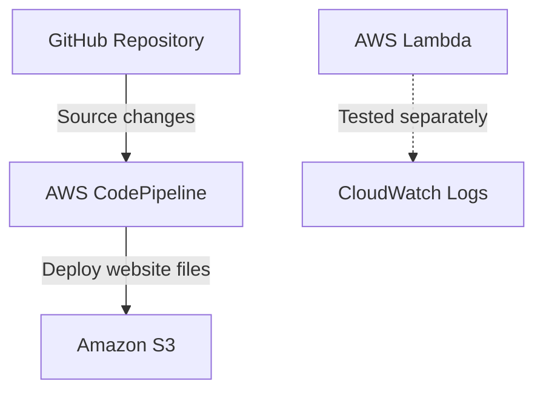

# CI/CD Automation Using AWS CodePipeline

## 1. Project Overview

This project demonstrates Continuous Integration and Continuous Deployment (CI/CD) using GitHub, AWS CodePipeline, and Amazon S3.

Whenever the source code is updated in the GitHub repository, AWS CodePipeline retrieves the latest version and deploys the website files to the configured Amazon S3 bucket.

## 2. Project Objectives

- Automate website deployment from GitHub to Amazon S3.
- Understand CI/CD pipeline concepts.
- Configure AWS CodePipeline with a GitHub source.
- Deploy website files to S3.
- Monitor pipeline executions and troubleshoot errors.

## 3. AWS Services Used

| Service | Purpose |
|---|---|
| GitHub | Stores the project source code |
| AWS CodePipeline | Automates the deployment workflow |
| Amazon S3 | Stores the deployed website files |
| AWS Lambda | Created and tested separately for automation |
| AWS IAM | Controls permissions between AWS services |
| Amazon CloudWatch | Provides logs for troubleshooting |

## 4. Architecture Diagram

**Note:** The active pipeline uses GitHub → AWS CodePipeline → Amazon S3. Lambda was tested separately and is not currently an action in the pipeline.

## 5. Project Configuration

- **AWS Region:** Asia Pacific (Mumbai) — `ap-south-1`
- **Pipeline Name:** `CICDDeploymentPipeline`
- **S3 Bucket:** `shital-cicd-deployment-2026-unique`
- **Lambda Function:** `CICDDeploymentAutomation`
- **GitHub Repository:** [CI-CD-Lambda-Project](https://github.com/Shital-7841/CI-CD-Lambda-Project)

## 6. Implementation Steps

1. Created